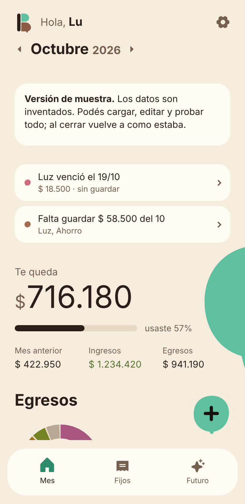
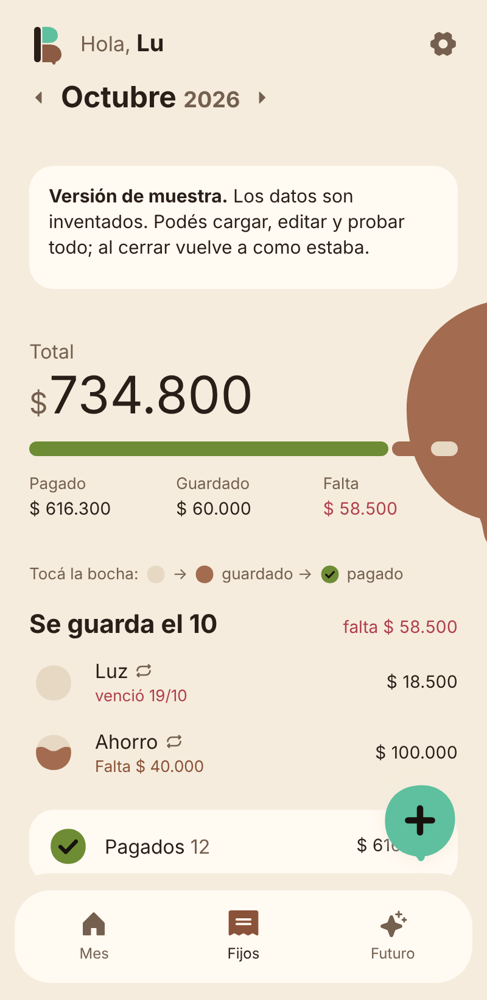
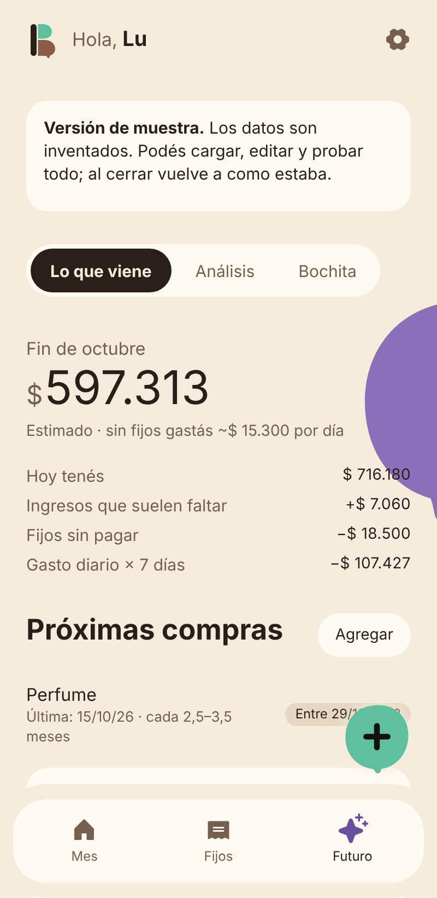
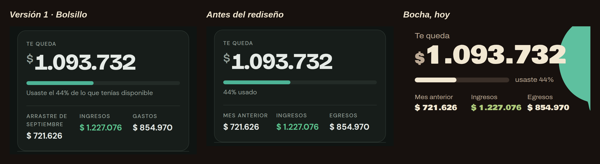

# Bocha · app de finanzas personales hecha con IA

Bocha es la app con la que manejo mi plata desde el celular. La armé desde cero en tres semanas trabajando con IA (Claude): yo definí el problema, las funciones y el diseño, y la IA me ayudó a construirla y probarla.

Esta es la **versión de muestra, con datos inventados**.

**[Probar la demo en vivo](https://solgonzalezizco.github.io/bocha-demo/)**

| Mes | Fijos | Futuro |
| --- | --- | --- |
|  |  |  |

---

## De dónde salió

Hace casi dos años que anoto todas mis finanzas, todos los días, en un Excel. Me funcionaba, pero quería tres cosas que la planilla no me daba:

- **Anotar en el momento**, desde el celular o la compu.
- **Datos más prolijos:** nombres, categorías, gastos fijos y cuotas cargados siempre igual.
- **Todo en un solo lugar**, incluida la plata que separo cada mes para los fijos.

La pregunta fue: ¿y si convierto mi Excel en una app?

## Cómo trabajé con la IA

No fue "haceme una app" y listo. Trabajé en ciclos cortos:

1. **Yo defino qué necesito.** Cuento el problema con mis palabras y decido qué entra y qué no.
2. **La IA propone y construye.** Plantea opciones, arma la función y la prueba con datos.
3. **La uso y ajusto.** Unos días de uso real me muestran qué falta, y vuelvo con cambios.

En **3 semanas** publiqué y usé **39 versiones**.

## Cómo fue creciendo

| Semana | Qué pasó |
| --- | --- |
| 1 · Nace "Bolsillo" | La base: el mes, los gastos fijos y una proyección de cuánto me queda a fin de mes. Importé los datos de mi Excel. |
| 2 · La uso y ajusto | Avisos de vencimientos. Al pagar un fijo, la app ofrece cargarlo como gasto. |
| 3 · Se vuelve "Bocha" | Fijos que se repiten solos y cuotas que terminan solas. Análisis de gastos, detección de excepciones y nombres unificados. Rediseño completo y nombre nuevo. |

## El rediseño

La app funcionaba bien, pero se veía genérica, "muy IA". Le pedí a la IA que pensara como una diseñadora profesional y rediseñamos desde un concepto.

- **El nombre:** de Bolsillo a Bocha, por "una bocha de plata", que es mucha plata.
- **El concepto:** una heladería de noche. Fondo casi negro, letras crema y el color de los gustos solo donde dice algo.
- **El color de marca:** verde agua, el de la menta.
- **Cada gasto fijo es una bocha** que se llena de chocolate a medida que guardo la plata.
- **La gotita derretida es la firma:** está en el logo, en el botón + y al final de cada tope.

Antes de tocar la app lo probé en un tablero de diseño: descarté seis tipografías y varias paletas hasta llegar a esta.

## Qué hace hoy

- **Mes:** saldo disponible, ingresos y egresos, gráfico por categoría, topes de gasto y lista de movimientos con filtros.
- **Fijos:** gastos fijos con estado (pendiente, guardado, pagado), vencimientos y cuotas que se cierran solas.
- **Futuro:** proyección del saldo a fin de mes, compras que se repiten, dónde ahorrar y topes sugeridos según los últimos tres meses.
- **Análisis:** en qué gasto, qué se repite y cómo viene el mes contra lo normal. Marca gastos fuera de lo común para que no distorsionen los promedios.
- **Bochita:** una asistente con IA que responde preguntas sobre mis números y arma gráficos. Solo funciona dentro de Claude, así que en esta demo aparece desactivada.

## Lo que muestra de análisis de datos

- **Ordenar antes de analizar:** unificación de nombres y categorías, y detección de excepciones.
- **Agregación** de movimientos por mes y por categoría.
- **Comparación** contra el mes anterior y contra el promedio de los últimos meses.
- **Detección de patrones:** gastos recurrentes, gastos que suben y gastos chicos que suman.
- **Proyección** del saldo a fin de mes según el gasto diario promedio.
- **Visualización:** gráfico de dona, barras y medidores de progreso.

## Cómo está hecha

- Un solo archivo `index.html` con HTML, CSS y JavaScript, sin librerías externas.
- Gráficos dibujados en SVG.
- Diseño pensado primero para el celular, con modo claro y oscuro.

Para probarla, abrí `index.html` en el navegador o entrá a la demo en vivo. Podés cargar, editar y borrar datos: al recargar vuelve a los datos de muestra.

## Lo que me llevo

Yo puse las ideas y el criterio; la IA puso la velocidad. Cada idea se podía probar en minutos en vez de días. Y aprendí algo que sirve para cualquier trabajo con datos: definir bien el problema, avanzar de a poco, probar con datos reales y ordenar la información antes de analizarla.

---

Sol González Izco · [LinkedIn](https://www.linkedin.com/in/sol-gonz%C3%A1lez-izco-9839b2286/)
